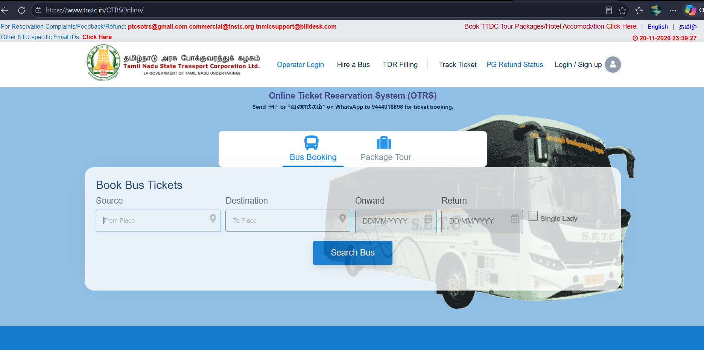
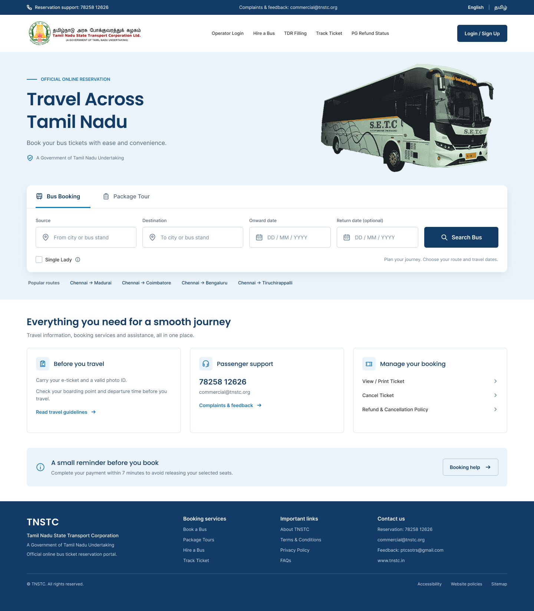
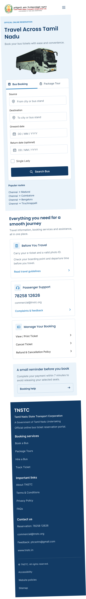

# TNSTC Website UI Redesign

Redesign of the TNSTC online bus reservation homepage to improve clarity, consistency and visual organization on desktop and mobile.

**Figma:** https://www.figma.com/design/RZSSmpKlsJUAOyz3qDqgME/ui-redesign?node-id=0-1&t=9KjRbiP1AO6AaqES-1

## Original Website

## Heuristic Evaluation
Evaluated the existing TNSTC homepage using Nielsen's usability heuristics.

| # | Heuristic | Observation | Recommendation |
|---|---|---|---|
| 1 | Visibility of system status | The booking action is not visually prominent. The Search Bus button floats alone below the fields. | Use a clear, full-width primary button placed directly with the fields. |
| 2 | Match between system and real world | The booking section has several fields that may feel crowded for first-time users. | Arrange fields in a familiar order: From, To, Onward date, Return date. |
| 3 | Consistency and standards | Navigation and information elements compete for attention, and fonts and link colours vary. | Keep consistent colours, typography, button styles and spacing. |
| 4 | Recognition rather than recall | Users must work out the purpose of fields and sections. Placeholders and labels have low contrast. | Use clear labels, recognizable icons, darker text and grouped information. |
| 5 | Aesthetic and minimalist design | Many elements share a limited space. The top bar is cluttered and the bus image shows through the form. | Use white space, clear section separation and a simple visual hierarchy. |

## Moodboard
**Design direction:** Modern, clean, corporate and user-friendly, inspired by TNSTC's identity.

**Keywords:** Trustworthy, Simple, Professional, Accessible, Organized, Travel-focused

**Visual references:** TNSTC's existing branding, SETC bus imagery, and clean bus-booking interfaces. The colour palette below carries this direction.

## Style Guide

**Colour palette**

| Colour | Hex | Usage |
|---|---|---|
| Navy Blue | #123B65 | Header, footer and primary elements |
| Corporate Blue | #1976B9 | Buttons and highlights |
| Light Blue | #EAF3FA | Background sections |
| White | #FFFFFF | Cards and main background |
| Dark Grey | #333333 | Body text |

**Typography:** Poppins. SemiBold for headings, Medium for subheadings, Regular for body text.

**UI components:** Blue buttons with white text, white input fields with subtle borders, light cards with clean spacing, simple navigation and minimal icons.

**Layout:** Clear visual hierarchy, consistent spacing, an organized booking form, and touch-friendly controls on mobile.

## Redesigned Desktop (1440 px)

## Redesigned Mobile (390 px)

## Conclusion
The evaluation found opportunities to improve the clarity, consistency and visual organization of the TNSTC homepage. The redesigned desktop and mobile layouts, supported by a consistent style guide, aim to give users a cleaner and more user-friendly booking experience.
